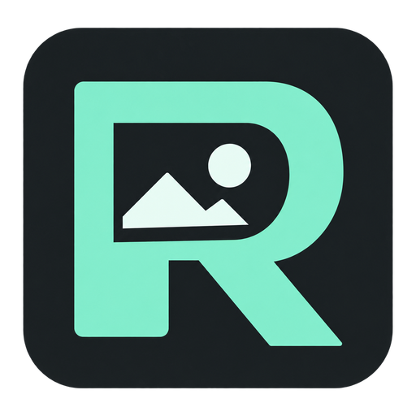

# RPG Asset Workbench（R-aW）

[繁體中文](../../README.md) · 简体中文 · [日本語](README.ja.md) · [English](README.en.md)

在 Windows 上管理 RPG Maker MV／MZ 的图片替换：保留固定原图、预览替换版本、批量配对，确认后应用到游戏，需要时还原。

当前源码版本为 **0.5.5**，正在准备 1.0 发布；本文不表示 1.0 已发布。目标平台为 Windows x64；最低 Windows 版本与 ARM64 尚未验证。

## 下载与启动

发布后请从本仓库的 **Releases** 页面下载 Windows x64 发行 ZIP。GitHub 的“Source code”ZIP 是源码，不能直接运行。如果没有发行附件，说明下载包尚未提供。

将发行 ZIP **完整解压**到可写入的文件夹，打开 `RPG Asset Workbench.exe`。保留同文件夹内的所有文件，不要只移动 EXE，也不要直接从压缩包内启动。打包后的程序不需要另行安装 Node.js。

## 开始使用

1. 先另外备份游戏。首次创建项目时选择可信、未修改的游戏副本，让工具保存固定原图基准。
2. 在首页创建项目、选择游戏位置，等待扫描完成。取消扫描会保留进度，可稍后继续；未完成时不能应用。
3. 在素材工作台搜索、浏览原始文件夹或创建自定义分组。原图与替换图均可点击放大。
4. 将单张静态 PNG 拖到素材行的替换图片栏，确认后导入；多张进入批量配对。多个候选需手动指定，确认前检查目标。
5. 选择版本只会形成待应用状态；点击应用到游戏并确认后才写入。进入游戏检查显示结果。
6. 选择原图也需要确认应用才生效；需要时使用还原功能。历史版本仍会保留。

首页语言图标可切换繁中、简中、英文与日文。项目设置可修改名称、封面及重新关联位置；自定义分组可改名、添加或移除素材。

## 数据、备份与删除

- 工具数据单独保存在 Windows 用户的应用数据目录，并非全部放在 EXE 旁。ZIP 可解压运行，不代表数据随程序文件夹一起移动。
- 升级前关闭程序，备份游戏和完整工具数据目录，将新版解压到另一个文件夹。如果旧项目没有出现，先停止操作并反馈，不要重新创建或删除旧数据。
- **永久删除项目会删除工具保存的原图、替换版本及关联数据，失去工具备份／还原能力。游戏保留删除时的图片状态，不会自动还原。** 如果需要原图，先还原并确认，再删除项目。
- 删除分组或分组内素材只移除分类关联。取消待应用与删除版本是不同操作；原图与已部署版本不能单独删除。
- 删除解压后的程序文件夹不等于清除工具数据；仍需要还原时，不要删除工具数据目录。

## 支持与限制

- 支持目标为 RPG Maker MV／MZ 未加密与标准图片加密；不保证支持自定义加密或修改过的引擎。
- 只接受静态 PNG，不接受 JPEG、APNG 或伪装扩展名。单文件上限 32 MiB。
- 一般上限 16,777,216 像素；替换／批量导入可确认处理较大图片，硬上限 33,554,432 像素。原图扫描和项目封面仍使用一般上限。
- 增量扫描只追加确认的新路径，不覆盖原图基准。游戏移动后可重新关联；离线可以查看保存的数据，但不能写入游戏。
- 外部修改冲突会阻止应用／还原，没有强制覆盖选项。操作失败时按提示恢复，并保留备份与错误信息。
- 干净 Windows 环境、最终发行包和升级兼容性仍有待验收项目；当前不是已完成全部平台验收的 1.0 正式版。

## 问题反馈与授权

请使用仓库的 Issues（如已启用），提供应用、Windows、引擎版本，重现步骤、预期与实际结果及错误截图。遮蔽个人路径，不要上传完整私人游戏、加密密钥或未获授权的素材。

本项目采用 [MIT 许可证](../../LICENSE)，Copyright © 2026 Zeke Gan。第三方组件与游戏素材仍遵循各自的授权；正式发布前仍需核对发行包中的第三方声明。

[版本更新](../UPDATE_0.5.5.md) · [开发与 AI 文档](../development/INDEX.md)
